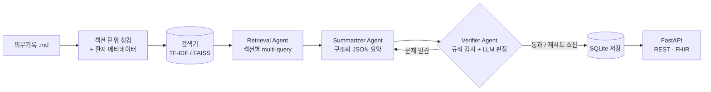

# MedRAG — LLM 기반 의료 문서 요약 · 검증 파이프라인

의무기록(퇴원요약, 외래 경과기록)을 검색해 **구조화된 퇴원요약 초안**을 만들고,
요약에 들어간 약물 · 용량 · 수치가 실제 기록에 있는지 **검증 에이전트가 다시 대조**하는 RAG 프로젝트입니다.
결과는 SQLite에 이력과 함께 저장되고, 병원정보시스템(HIS) 연동을 가정해 **REST API**와 **HL7 FHIR Composition** 형식으로 제공합니다.

> ⚠️ `data/notes/`의 모든 문서는 학습용으로 직접 작성한 **가상 환자 기록**입니다. 실제 환자 정보가 아니며 임상 판단에 사용하면 안 됩니다.

---

## 왜 만들었나

의료 문서 요약에서 가장 위험한 실패는 **그럴듯하지만 기록에 없는 내용**(가짜 약물, 틀린 용량)을 만들어내는 것입니다.
그래서 "요약을 잘 쓰는 것"보다 **"근거 밖으로 나가지 않게 하고, 나갔으면 잡아내는 것"** 에 초점을 맞췄습니다.

| 설계 | 이유 |
|---|---|
| 섹션 단위 청킹 | 주호소 · 진단명 · 퇴원 약물처럼 섹션마다 의미가 달라, 글자 수로 자르면 약물 목록이 쪼개짐 |
| 환자 ID 메타데이터 필터 | 다른 환자의 기록이 요약에 섞이는 사고 방지 |
| 구조화 출력 (Pydantic 스키마) | 항목별로 근거 대조가 가능하고, HIS로 넘기기 쉬움 |
| 검증 에이전트 + 재작성 루프 | 근거에 없는 약물 · 용량 · 수치 · 인용을 찾아 요약 에이전트에 피드백 |
| 검증 결과와 함께 저장 | AI 요약은 의료진 확인 전까지 초안 → 통과 여부 · 문제 · 모델을 추적 |

## 아키텍처



- **오케스트레이션**: 같은 노드 함수(retrieve → summarize → verify → save)를 **LangGraph `StateGraph`**로 컴파일해 실행하거나, 의존성 없는 순수 Python 루프로 실행할 수 있습니다.
- **LLM**: LangChain `ChatOpenAI` / `ChatOllama` 중 선택. API 키 없이 전체 흐름을 테스트할 수 있도록 규칙 기반 `dryrun` 백엔드도 제공합니다.
- **검색기**: 오프라인 기준선인 문자 n-gram **TF-IDF**와, 한국어 문장 임베딩(`jhgan/ko-sroberta-multitask`) + **LangChain FAISS** 벡터 검색 중 선택합니다.

## 폴더 구조

```
medical-rag-summarizer/
├── src/medrag/
│   ├── loader.py     # front matter 파싱, 섹션 단위 청킹
│   ├── retriever.py  # TF-IDF / FAISS 검색기 (환자 필터 공통 인터페이스)
│   ├── prompts.py    # 요약 · 검증 · 질의응답 프롬프트
│   ├── llm.py        # LangChain 채팅 모델 래퍼, dryrun 백엔드
│   ├── agents.py     # Retrieval · Summarizer · Verifier 에이전트
│   ├── graph.py      # 파이프라인 오케스트레이션 (LangGraph)
│   ├── schema.py     # Pydantic 요약 스키마, FHIR Composition 변환
│   ├── store.py      # SQLite 저장소
│   └── qa.py         # 근거 인용 질의응답
├── api/main.py       # FastAPI 엔드포인트
├── scripts/
│   ├── demo.py       # CLI 데모
│   └── evaluate.py   # 검색 · 검증 · 환각 탐지 평가
├── data/notes/       # 가상 의무기록 6건 (환자 5명)
├── data/eval/        # 평가용 질문 12개
├── tests/            # 단위 · API 테스트
└── Dockerfile
```

## 실행 방법

```bash
pip install -r requirements.txt
export PYTHONPATH=src
```

**1) 오프라인 실행 (API 키 불필요)**
```bash
python scripts/demo.py --patient P001 --question "클로피도그렐은 언제 중단하나요?" --fhir
python scripts/evaluate.py
python -m pytest tests
```

**2) 실제 LLM + 임베딩 검색**
```bash
export LLM_PROVIDER=openai OPENAI_API_KEY=sk-...   # 또는 LLM_PROVIDER=ollama (로컬 모델)
export RETRIEVER=faiss
python scripts/demo.py --patient P004 --langgraph
python scripts/evaluate.py
```

**3) API 서버**
```bash
uvicorn api.main:app --reload        # http://localhost:8000/docs
```

| 메서드 | 경로 | 설명 |
|---|---|---|
| `POST` | `/summaries` | `{"patient_id": "P001"}` → 요약 생성 · 검증 · 저장 |
| `GET` | `/summaries/{patient_id}` | 최신 요약과 검증 결과 |
| `GET` | `/summaries/{patient_id}/fhir` | 최신 요약을 FHIR Composition으로 반환 |
| `POST` | `/ask` | `{"question": "...", "patient_id": "P001"}` → 근거 인용 답변 |

**4) Docker**
```bash
docker build -t medrag .
docker run -p 8000:8000 -e LLM_PROVIDER=dryrun medrag
```

## 평가

`scripts/evaluate.py`는 세 가지를 측정합니다.

1. **검색 성능** — 질문 12개에 대해 정답 문서 · 섹션이 몇 위에 나오는지 (Hit@1, Hit@4, MRR)
2. **요약 검증 통과율** — 환자 5명의 요약이 검증 에이전트를 통과한 비율
3. **환각 탐지율** — 정상 요약에 ① 가짜 약물 ② 틀린 용량 ③ 기록에 없는 수치를 주입했을 때 검증 에이전트가 잡아낸 비율

### 오프라인 기준선 (TF-IDF + dryrun)

| 지표 | 결과 |
|---|---|
| 검색 Hit@1 / Hit@4 / MRR | 0.67 / 0.92 / 0.76 |
| 요약 검증 통과율 | 1.00 (5/5) |
| 환각 탐지율 — 가짜 약물 / 틀린 용량 / 없는 수치 | 1.00 / 1.00 / 1.00 |

- TF-IDF는 글자가 겹쳐야 찾을 수 있어서 "케톤산증이 생긴 **원인**은?"처럼 기록에 같은 표현이 없는 질문(정답: "인슐린을 임의로 중단함")을 놓쳤습니다. 의미 기반 임베딩 검색(`RETRIEVER=faiss`)이 필요한 이유입니다.
- 요약 통과율 1.00은 dryrun이 기록을 그대로 추출하기 때문에 나오는 값으로, **LLM 성능을 뜻하지 않습니다.**
- 환각 탐지 테스트는 일부러 만든 오류에 대한 것이며, 표현을 바꿔 쓴 오류(예: "아스피린 증량")까지 잡는지는 LLM 판정자로 보완해야 합니다.

### 실제 LLM 결과

| 설정 | 검색 Hit@1 | Hit@4 | MRR | 요약 검증 통과율 | 평균 재작성 횟수 |
|---|---|---|---|---|---|
| FAISS + gpt-4o-mini | | | | | |
| FAISS + Ollama (qwen2.5:7b) | | | | | |

## 한계와 개선 방향

- 가상 기록 6건으로 만든 소규모 실험입니다. 공개 데이터셋(MIMIC-IV-Note 등, 사용 승인 필요)으로 확장해 평가할 계획입니다.
- 규칙 기반 검증은 약물명 · 숫자 일치만 봅니다. 의미 수준 검증은 LLM 판정자에 의존하므로, 판정자 자체의 정확도 평가가 필요합니다.
- 검색 성능 개선: 하이브리드 검색(BM25 + 임베딩), 리랭커 적용.
- 운영 관점: 요약 요청 · 검증 실패율 로깅, 모델 버전별 결과 비교 등 MLOps 구성.

## 기술 스택

Python · LangChain · LangGraph · FAISS · Sentence-Transformers · scikit-learn · Pydantic · FastAPI · SQLite · Docker · HL7 FHIR
