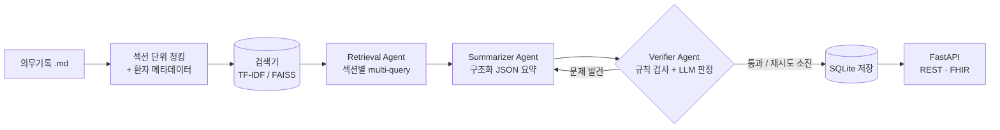

# MedRAG — LLM 기반 의료 문서 요약 · 검증 파이프라인

의무기록(퇴원요약, 외래 경과기록)을 검색해 **구조화된 퇴원요약 초안**을 만들고,
요약에 들어간 약물 · 용량 · 수치가 실제 기록에 있는지 **검증 에이전트가 다시 대조**하는 RAG 프로젝트입니다.
결과는 SQLite에 이력과 함께 저장되고, 병원정보시스템(HIS) 연동을 가정해 **REST API**와 **HL7 FHIR Composition** 형식으로 제공합니다.

> ⚠️ `data/notes/`의 모든 문서는 학습용으로 직접 작성한 **가상 환자 기록**입니다. 실제 환자 정보가 아니며 임상 판단에 사용하면 안 됩니다.

---

## 왜 만들었나

의료 문서 요약에서 가장 위험한 실패는 **그럴듯하지만 기록에 없는 내용**(가짜 약물, 틀린 용량)을 만들어내는 것입니다.
그래서 "요약을 잘 쓰는 것"보다 **"근거 밖으로 나가지 않게 하고, 나갔으면 잡아내는 것"**에 초점을 맞췄습니다.

| 설계 | 이유 |
|---|---|
| 섹션 단위 청킹 | 주호소 · 진단명 · 퇴원 약물처럼 섹션마다 의미가 달라, 글자 수로 자르면 약물 목록이 쪼개짐 |
| 환자 ID 메타데이터 필터 | 다른 환자의 기록이 요약에 섞이는 사고 방지 |
| 구조화 출력 (Pydantic 스키마) | 항목별로 근거 대조가 가능하고, HIS로 넘기기 쉬움 |
| 검증 에이전트 + 재작성 루프 | 근거에 없는 약물 · 용량 · 수치 · 인용을 찾아 요약 에이전트에 피드백 |
| 검증 결과와 함께 저장 | AI 요약은 의료진 확인 전까지 초안 → 통과 여부 · 문제 · 모델을 추적 |

## 아키텍처



- **오케스트레이션**: 같은 노드 함수(retrieve → summarize → verify → save)를 **LangGraph `StateGraph`**로 컴파일해 실행하거나, 의존성 없는 순수 Python 루프로 실행할 수 있습니다.
- **LLM**: LangChain `ChatOpenAI` / `ChatOllama` 중 선택. API 키 없이 전체 흐름을 테스트할 수 있도록 규칙 기반 `dryrun` 백엔드도 제공합니다.
- **검색기**: 오프라인 기준선인 문자 n-gram **TF-IDF**와, 한국어 문장 임베딩(`jhgan/ko-sroberta-multitask`) + **LangChain FAISS** 벡터 검색 중 선택합니다.

## 폴더 구조

```
medical-rag-summarizer/
├── src/medrag/
│   ├── loader.py     # front matter 파싱, 섹션 단위 청킹
│   ├── retriever.py  # TF-IDF / FAISS 검색기 (환자 필터 공통 인터페이스)
│   ├── prompts.py    # 요약 · 검증 · 질의응답 프롬프트
│   ├── llm.py        # LangChain 채팅 모델 래퍼, dryrun 백엔드
│   ├── agents.py     # Retrieval · Summarizer · Verifier 에이전트
│   ├── graph.py      # 파이프라인 오케스트레이션 (LangGraph)
│   ├── schema.py     # Pydantic 요약 스키마, FHIR Composition 변환
│   ├── store.py      # SQLite 저장소
│   └── qa.py         # 근거 인용 질의응답
├── api/main.py       # FastAPI 엔드포인트
├── scripts/
│   ├── demo.py       # CLI 데모
│   └── evaluate.py   # 검색 · 검증 · 환각 탐지 평가
├── data/notes/       # 가상 의무기록 6건 (환자 5명)
├── data/eval/        # 평가용 질문 12개
├── tests/            # 단위 · API 테스트
└── Dockerfile
```

## 실행 방법

```bash
pip install -r requirements.txt
export PYTHONPATH=src
```

**1) 오프라인 실행 (API 키 불필요)**
```bash
python scripts/demo.py --patient P001 --question "클로피도그렐은 언제 중단하나요?" --fhir
python scripts/evaluate.py
python -m pytest tests
```

**2) 실제 LLM + 임베딩 검색**
```bash
export LLM_PROVIDER=openai OPENAI_API_KEY=sk-...   # 또는 LLM_PROVIDER=ollama (로컬 모델)
export RETRIEVER=faiss
python scripts/demo.py --patient P004 --langgraph
python scripts/evaluate.py
```

**3) API 서버**
```bash
uvicorn api.main:app --reload        # http://localhost:8000/docs
```

| 메서드 | 경로 | 설명 |
|---|---|---|
| `POST` | `/summaries` | `{"patient_id": "P001"}` → 요약 생성 · 검증 · 저장 |
| `GET` | `/summaries/{patient_id}` | 최신 요약과 검증 결과 |
| `GET` | `/summaries/{patient_id}/fhir` | 최신 요약을 FHIR Composition으로 반환 |
| `POST` | `/ask` | `{"question": "...", "patient_id": "P001"}` → 근거 인용 답변 |

**실행 예시**: Swagger UI에서 `POST /summaries`에 `{"patient_id": "P001"}`을 보낸 응답 (FAISS + gpt-4o-mini)


> 이 응답에는 아래 [결과 해석 3](#결과-해석)에서 다룬 문제가 그대로 보입니다. 퇴원 약물에 실제 퇴원 처방 4개(아스피린, 클로피도그렐, 아토르바스타틴, 암로디핀) 대신 입원 중 투여한 혈전용해제 `alteplase`가 들어갔는데도 `issues`가 비어 있어 검증을 통과했습니다.

**4) Docker**
```bash
docker build -t medrag .
docker run -p 8000:8000 -e LLM_PROVIDER=dryrun medrag
```

## 평가

`scripts/evaluate.py`는 세 가지를 측정합니다.

1. **검색 성능**: 질문 12개마다 정답 문서 · 섹션이 몇 위에 나오는지 (Hit@1, Hit@4, MRR)
2. **요약 검증 통과율**: 환자 5명의 요약 중 검증 에이전트를 통과한 비율
3. **환각 탐지율**: 정상 요약에 ① 가짜 약물 ② 틀린 용량 ③ 기록에 없는 수치를 일부러 넣었을 때, 규칙 기반 검증이 잡아낸 비율

| 설정 | 검색기 | LLM |
|---|---|---|
| 오프라인 기준선 | 문자 n-gram TF-IDF | dryrun (규칙 기반 추출) |
| 실제 실험 | FAISS + `jhgan/ko-sroberta-multitask` | OpenAI `gpt-4o-mini` |

### 결과 요약

| 지표 | TF-IDF + dryrun | FAISS + gpt-4o-mini |
|---|:---:|:---:|
| 검색 Hit@1 | **0.67** | 0.58 |
| 검색 Hit@4 | **0.92** | 0.83 |
| 검색 MRR | **0.76** | 0.69 |
| 요약 검증 통과율 (5명) | 1.00 | 1.00 |
| 환각 탐지: 가짜 약물 | 1.00 | 1.00 |
| 환각 탐지: 틀린 용량 | 1.00 | **0.20** ⚠️ |
| 환각 탐지: 없는 수치 | 1.00 | 1.00 |

### 질문별 검색 순위 (정답 섹션이 몇 위였는지)

| 질문 | 정답 섹션 | TF-IDF | FAISS |
|---|---|:---:|:---:|
| P001 혈전용해제 투여 여부 | 입원 경과 | 1 | 2 |
| P001 클로피도그렐 중단 시점 | 외래 · 입원 경과 | 1 | 1 |
| P001 퇴원 시 NIHSS 점수 | 입원 경과 | 1 | 2 |
| P002 객담 배양 결과 | 검사 소견 | 1 | 1 |
| P002 퇴원 항생제 | 퇴원 약물 | 4 | 4 |
| P003 케톤산증 원인 | 현병력 | ✗ | ✗ |
| P003 기저 인슐린 용량 | 퇴원 약물 | 3 | 1 |
| P004 관상동맥조영술 결과 | 검사 소견 | 2 | 1 |
| P004 티카그렐러 복용 기간 | 퇴원 약물 | 1 | 1 |
| P005 수술 종류 | 입원 경과 | 1 | 1 |
| P005 수술 후 활동 제한 | 추적 관찰 계획 | 1 | 1 |
| 우하엽 경화 환자의 진단명 (환자 지정 없음) | P002 검사 소견 | 1 | ✗ |

✗ = 상위 4개 안에 없음

### 결과 해석

**1. 임베딩 검색이 TF-IDF보다 항상 낫지는 않았습니다.**
- FAISS는 약물명이나 시술명이 질문에 그대로 들어간 경우(P003 기저 인슐린, P004 관상동맥조영술)에 순위를 올렸습니다.
- 반대로 "우하엽 경화", "NIHSS", "혈전용해제"처럼 **의학 용어가 정확히 일치해야 하는 질문**에서는 TF-IDF보다 못했습니다. 환자를 지정하지 않은 질문에서는 다른 환자(P004, P001, P005)의 검사 소견을 가져왔습니다.
- 범용 한국어 문장 임베딩은 의학 용어를 구분하는 힘이 약하다는 뜻입니다. 두 방식의 장점이 달라서, 키워드 검색(BM25)과 임베딩을 함께 쓰는 **하이브리드 검색**이 다음 단계로 필요합니다.

**2. 의미 기반 검색으로도 풀리지 않은 질문이 있습니다.**
- "케톤산증이 생긴 **원인**은?"의 정답은 현병력의 "인슐린을 임의로 중단함"입니다. 처음에는 임베딩 검색이 이런 질문을 해결할 것으로 예상했지만, 두 검색기 모두 실패했습니다.
- 질문과 답의 표현이 완전히 다를 때는 임베딩만으로 부족했습니다. 질의 재작성(query rewriting · HyDE)이나 리랭커 적용을 검토하고 있습니다.

**3. "틀린 용량 탐지 0.20"은 검증 규칙이 아니라 요약 쪽 문제를 드러낸 결과입니다.**
- 이 테스트는 요약의 첫 번째 약물 용량을 `999 mg`으로 바꿉니다. 규칙 검사는 결정적(deterministic)이라, 바뀐 용량이 있으면 반드시 잡아냅니다.
- 따라서 탐지에 실패한 4명은 **요약의 퇴원 약물 목록이 비어 있어서** 바꿀 약물 자체가 없었던 경우로 해석됩니다.
- 원인으로는 요약용 검색(섹션별 질의당 상위 2개)이 "퇴원 약물" 섹션을 놓쳤을 가능성이 큽니다. 위 표에서 약물 질문(P002 항생제)의 정답 순위가 4위였던 것과 같은 흐름입니다.
- 이 경우 요약에서 약물이 빠져도 검증을 통과하므로, **검증 통과율 1.00도 낙관적인 수치**입니다. 현재 검증은 "있는 내용이 맞는가(정확성)"만 보고 "있어야 할 내용이 다 있는가(완전성)"는 보지 않기 때문입니다.
- [실행 예시](#실행-방법)의 P001 응답이 이를 보여 줍니다. 근거(`sources`)에 "퇴원 약물" 섹션이 없었고, 모델은 입원 경과에 나온 `alteplase`를 퇴원 약물로 옮겨 적었습니다. alteplase라는 이름 자체는 기록에 있으므로 규칙 검사를 통과했습니다. **약물이 기록에 있는지뿐 아니라 어느 섹션에서 왔는지**도 확인해야 한다는 뜻입니다.

### 다음 단계 (평가 결과에서 나온 개선 항목)

- [ ] 완전성 검사 추가: 기록에 퇴원 약물 섹션이 있는데 요약 약물 목록이 비어 있으면 검증 실패로 처리
- [ ] 섹션 출처 검사 추가: 퇴원 약물은 "퇴원 약물" 섹션 근거에서만 나오도록 확인 (입원 중 투여 약물 혼입 방지)
- [ ] 환각 주입 평가 보정: 약물이 없는 요약은 "틀린 용량" 테스트에서 제외하고, 제외한 수를 따로 보고
- [ ] 요약용 검색 보강: 진단명 · 퇴원 약물처럼 필수 섹션은 메타데이터로 직접 가져오기
- [ ] 하이브리드 검색(BM25 + 임베딩)과 리랭커로 검색 재평가
- [ ] 로컬 모델(Ollama `qwen2.5:7b`)과 결과 비교

> 기준선 수치(요약 통과율 1.00, 환각 탐지 1.00)는 dryrun이 기록을 그대로 추출해서 나온 값이며 LLM 성능을 뜻하지 않습니다. 모든 수치는 가상 기록 6건 · 질문 12개 규모의 소규모 실험 결과입니다.

## 한계

- 가상 기록 6건으로 만든 소규모 실험입니다. 공개 데이터셋(MIMIC-IV-Note 등, 사용 승인 필요)으로 확장해 평가할 계획입니다.
- 규칙 기반 검증은 약물명 · 용량 · 숫자 일치만 확인합니다. 의미 수준 검증은 LLM 판정자에 맡기므로, 판정자 자체의 정확도도 따로 평가해야 합니다.
- 운영 측면에서는 요약 요청 · 검증 실패율 로깅, 모델 버전별 결과 비교 같은 MLOps 구성이 아직 없습니다.

## 기술 스택

Python · LangChain · LangGraph · FAISS · Sentence-Transformers · scikit-learn · Pydantic · FastAPI · SQLite · Docker · HL7 FHIR
